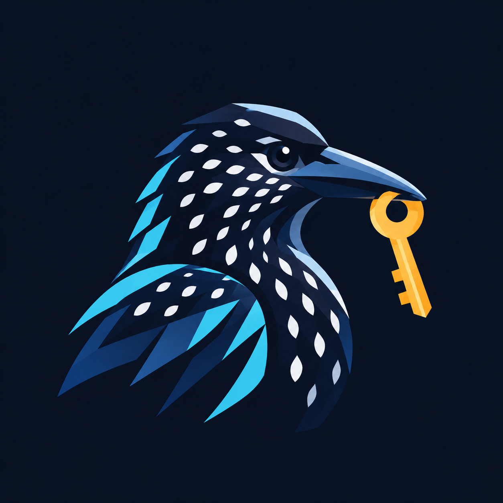

<div align="center">
  
  <h1>Nutcracker 🔐</h1>
  <p><strong>A lightweight, ultra-secure native desktop API key manager built with Tauri v2 + Rust</strong></p>
  <p><em>"Like the nutcracker bird caching thousands of seeds across the wild, Nutcracker securely stores, encrypts, and retrieves all your API keys with absolute precision."</em></p>

  <p>
    
    
    
    
    
  </p>
</div>

---

## 🌟 Why Nutcracker?

Most API keys for modern AI platforms and cloud services (OpenAI, Anthropic, Gemini, AWS, GitHub) are displayed **only once** upon generation. Storing them in plaintext files, note apps, or unencrypted shell profiles risks severe security leaks.

**Nutcracker** provides a unified, local-first encrypted vault for all your API keys with zero cloud lock-in, zero telemetry, and instant desktop access.

---

## 🛡️ Architecture & Security Features

- **Tauri v2 Native Desktop Engine**:
  - Leverages macOS WKWebView and Linux WebKitGTK directly—**no Chromium/Node.js bloat**.
  - Tiny memory footprint (**~30MB**) and instant (<50ms) startup time.
  - Native binary packages as small as **1.8 MB** (Linux) and **3.0 MB** (macOS).
- **Military-Grade Cryptography**:
  - **AES-256-GCM** authenticated symmetric encryption.
  - **PBKDF2-HMAC-SHA256** key derivation with **310,000 iterations** to defeat brute-force dictionary attacks.
  - POSIX `0600` strict file permissions and atomic write/swap to eliminate vault corruption risks.
- **Modern Dark UI**:
  - Auto-categorization (OpenAI, Anthropic, AWS, GitHub, Google, Groq, Custom).
  - Instant fuzzy search & filtering by platform name or notes.
  - One-click copy-to-clipboard with masked credential view.
  - Master password migration & full JSON export.
- **Dual Runtime & Cross-Platform Compatibility**:
  - Runs natively on **macOS (Apple Silicon & Intel)** and **Linux (x86_64)**.
  - Backed by an automated test suite verifying 100% data interop across runtimes.

---

## 🚀 Quick Start

### 1. Prebuilt Packages (Direct Download)

Pre-compiled lightweight installation packages are available:

- **macOS (Apple Silicon / arm64)**:
  - 📀 [Nutcracker-v0.1.0-arm64.dmg](dist/Nutcracker-v0.1.0-arm64.dmg) (3.0 MB) — Drag into `Applications` to install.
  - 📦 [Nutcracker-v0.1.0-arm64.zip](dist/Nutcracker-v0.1.0-arm64.zip) (2.6 MB) — Portable archive.
- **Linux (x86_64)**:
  - 🐧 [nutcracker_0.1.0_amd64.deb](dist/nutcracker_0.1.0_amd64.deb) (1.8 MB) — `sudo dpkg -i nutcracker_0.1.0_amd64.deb`
  - 📦 [Nutcracker-v0.1.0-linux-x86_64.tar.gz](dist/Nutcracker-v0.1.0-linux-x86_64.tar.gz) (2.5 MB) — Portable with `install.sh`.

### 2. Run from Source

```bash
# Clone the repository
git clone https://github.com/yourwayai/nutcracker.git
cd nutcracker

# Option A: Run via launcher script
./run.sh

# Option B: Run via Cargo directly
cargo run --release --manifest-path src-tauri/Cargo.toml

# Option C: Double-click Nutcracker.command in macOS Finder
```

### 3. First-Time Setup

1. On initial launch, set your **Master Password** (minimum 8 characters).
2. Add your API keys categorized by platform.
3. Use the search bar for fast retrieval and click **Copy** whenever you need to use an API key in your code.
4. Click **Lock Vault** or close the window when done.

---

## 🧪 Testing

Nutcracker includes an extensive automated regression test suite covering cryptographic primitives, server endpoints, and cross-language interoperability:

```bash
python3 tests/run_all.py
```

---

## 📄 License

MIT License. Designed with security and privacy in mind.
