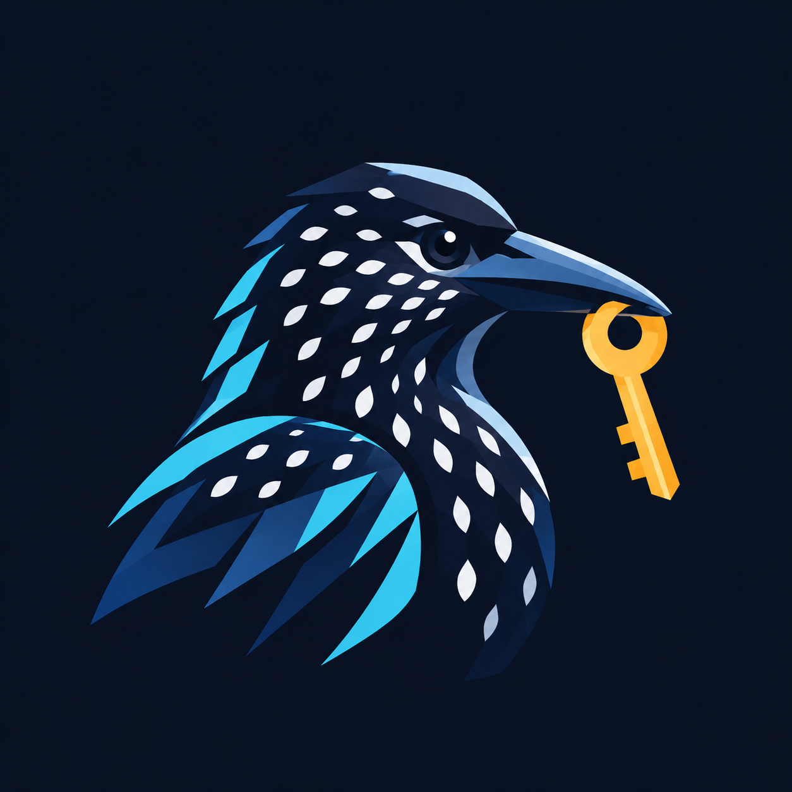

<div align="center">
  
  <h1>Nutcracker 🔐</h1>
  <p><strong>基于 Tauri v2 + Rust 构建的超轻量、金融级安全本地 API 密钥管理器</strong></p>
  <p><em>“如同星鸦在荒野中藏匿数万颗种子并精准取回，Nutcracker 以极高精度安全加密、存储和检索你的所有 API 密钥。”</em></p>

  <p>
    <a href="README.md">English</a> •
    <a href="README_CN.md">简体中文</a>
  </p>

  <p>
    
    
    
    
    
  </p>
</div>

---

## 🌟 为什么需要 Nutcracker？

在当前 AI 与云原生开发时代，大部分主流平台（OpenAI、Anthropic、Google Gemini、AWS、GitHub 等）的 **API Key 在生成时均“仅展示一次”**。许多开发者习惯将其随手记在明文文本、备忘录或未加密的环境变量配置文件中，极易引发严重凭据泄露。

**Nutcracker**（星鸦）专为解决这一痛点而生：
- **纯本地私有**：零云端依赖、零数据遥测上报，密钥完全保存在本地受保护的加密金库中。
- **即开即用**：毫秒级极速呼出，一键复制，不再为翻找历史 Key 或反复重新生成凭证而烦恼。

---

## 🛡️ 架构与安全特性

- **Tauri v2 + Rust 原生极轻桌面引擎**：
  - 直接调用系统原生渲染内核（macOS WKWebView / Linux WebKitGTK），彻底告别传统 Electron 庞大的 Chromium/Node.js 运行时负担。
  - **极致轻量**：启动时间 < 50ms，常驻内存仅约 **30MB**。
  - **安装包体积小巧**：Linux 安装包仅 **1.8 MB**，macOS 镜像仅 **3.0 MB**。
- **高安全级别加密实现**：
  - **AES-256-GCM** 认证对称加密，防篡改、防伪造。
  - **PBKDF2-HMAC-SHA256** 密钥衍生（高达 **310,000 次哈希迭代**），从根源杜绝离线字典与暴力穷举破解。
  - 采用 POSIX `0600` 专用安全文件权限与**原子替换写入**（Atomic Swap），防止断电或意外退出导致金库损坏。
- **现代化暗色交互界面**：
  - 自动预置主流 AI 与云服务分类（OpenAI、Anthropic、AWS、GitHub、Google、Groq、Custom 等）。
  - 支持按服务商或备注进行实时模糊搜索与动态过滤。
  - 敏感凭据默认脱敏掩码展示，支持一键点击直拷剪贴板。
  - 支持金库主密码在线修改、明文/脱敏 JSON 导出与安全迁移。
- **跨平台与双运行时数据互通**：
  - 原生支持 **macOS（Apple Silicon M系列及 Intel 架构）** 和 **Linux（x86_64）**。
  - 具备 Rust 原生内核与 Python 3 备用双运行时，经完备回归测试，两套环境生成的加密金库可 100% 互相解密，绝不产生厂商锁死。

---

## 🚀 快速开始

### 1. 预编译安装包直接下载

我们为常见操作系统编译了即开即用的独立安装包：

- **macOS（Apple Silicon / arm64）**：
  - 📀 [Nutcracker-v0.1.0-arm64.dmg](dist/Nutcracker-v0.1.0-arm64.dmg) (3.0 MB) — 打开后直接拖动到 `Applications` 即可安装。
  - 📦 [Nutcracker-v0.1.0-arm64.zip](dist/Nutcracker-v0.1.0-arm64.zip) (2.6 MB) — 免安装便携压缩包。
- **Linux（x86_64）**：
  - 🐧 [nutcracker_0.1.0_amd64.deb](dist/nutcracker_0.1.0_amd64.deb) (1.8 MB) — Debian / Ubuntu 用户：`sudo dpkg -i nutcracker_0.1.0_amd64.deb`
  - 📦 [Nutcracker-v0.1.0-linux-x86_64.tar.gz](dist/Nutcracker-v0.1.0-linux-x86_64.tar.gz) (2.5 MB) — 通用 Linux 便携包，内含 `install.sh` 脚本与桌面图标。

### 2. 源码构建与运行

如果你希望从源码运行或二次开发：

```bash
# 克隆仓库
git clone https://github.com/yourwayai/nutcracker.git
cd nutcracker

# 方式 A：通过快捷启动脚本运行（优先调用已编译 Release 原生程序）
./run.sh

# 方式 B：直接通过 Cargo 运行 Tauri 原生桌面端
cargo run --release --manifest-path src-tauri/Cargo.toml

# 方式 C（macOS）：在访达（Finder）中直接双击 Nutcracker.command
```

### 3. 首次使用流程

1. **创建金库**：首次打开应用时，设置你的专属 **主密码（Master Password）**（最少 8 位）。
2. **录入密钥**：点击“添加密钥”，选择分类平台并填入你的 API Key。
3. **日常调用**：需要使用时，通过搜索框秒级定位，点击复制按钮即可；使用完毕随时点击右上角或快捷键 **锁定金库**。

---

## 🧪 自动化测试套件

Nutcracker 包含完整的全流程自动化回归测试套件，涵盖底层加密原语、服务端 API 接口及 Rust / Python 跨语言数据互通验证：

```bash
python3 tests/run_all.py
```

*测试覆盖项目包含：*
- 310,000 次 PBKDF2 衍生一致性与 AES-256-GCM 往返测试
- 单字节篡改侦测与非法 Tag 拦截测试
- 金库创建、解锁、保存、修改主密码及导出全生命周期
- Rust 与 Python 双向互解与数据无缝兼容校验

---

## 📄 开源许可

本项目采用 [MIT 许可证](LICENSE)。保护个人隐私与敏感资产安全，从本地加密做起。
